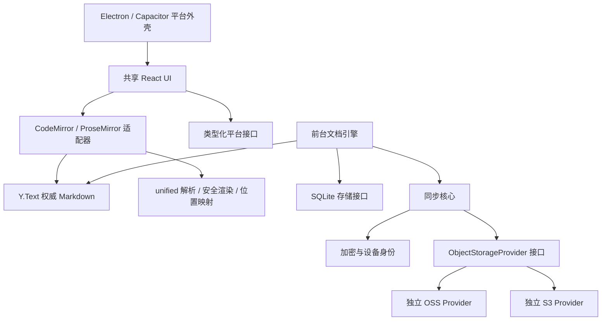

# JoplinU 架构决策与阶段边界

状态：阶段 0 设计和阶段 1 浏览器技术原型；不是可用于真实笔记的发布版本。优先级：不丢失数据 > 同步正确性 > 编辑体验 > 平台一致性 > 性能与外观。

## 仓库实查（2026-10-22）

目标仓库 `UlinoyaPed/joplinu` 默认分支 `dev`，起点 `585ec251b056eb0665f6a2e0eee4e012b32e2f6e`（Doc: Auto-update documentation）。远端检查时只有 `dev` 分支。本地浅克隆初始工作区干净。它已经包含完整 Joplin 工程：根 Yarn 4.16 workspace，Electron 桌面、React Native 移动端、CodeMirror / ProseMirror 编辑器、SQLite、本地模型、同步和加密实现，并非空的新工程。没有发现 AGENTS.md；读取并遵循根 CLAUDE.md 中适用的工程约定。

保留所有原有应用、配置、许可证、资源与数据路径。新工程暂置于 `experiments/joplinu/`，以独立 npm workspace、锁文件和严格 tsconfig 验证新架构，避免触发旧工程全部原生依赖安装。它不属于旧根 workspace，不导入任何 `@joplin/*` 模块。根 TypeScript 排除该目录，新工程自行检查。原型成功后可以在单独 PR 中提升为正式 apps/packages 工程；现在不迁移旧项目，也不改旧数据库。

参考并读取了原有 `packages/editor/CodeMirror/extensions/rendering/`、`ProseMirror/schema.ts` 附近的模块结构、`ProseMirror/utils/UndoStackSynchronizer.ts`、`packages/lib/Synchronizer.ts`、`readme/dev/spec/{sync,sync_scroll}.md`、`readme/dev/spec/e2ee/native_encryption.md`。采用其分层、选区避让和源码位置映射经验，没有复制实现或同步协议。根 LICENSE 默认 AGPL-3.0-or-later 继续适用；未复用 Joplin 商标图标。

## 模块与依赖方向

当前实现只有 `apps/playground`、`packages/document`、`packages/editor` 和 `packages/markdown`。其余是后续设计边界，不能作为已实现功能。原型各目录尚使用相对 TS 入口；依赖在原型 workspace 根集中锁定，待边界稳定后拆成独立可发布包。

业务核心不能依赖 Electron、Capacitor、DOM、SDK 或应用全局状态。编辑器可以依赖 DOM，Markdown 解析与 HTML 字符串生成不依赖浏览器。云 SDK 只能位于各自 Provider。跨进程调用使用逐项校验的白名单 IPC，禁止通用执行 / 任意文件路径代理。

## ADR-001：先验证原始 Markdown + Y.Text

一个 note 一个 Y.Doc，权威内容为命名 `markdown` 的 Y.Text。初始化只允许一次创建共享基线，不能让设备分别插入同一份 Markdown 再连接，否则会重复内容。原型的设备 B 从设备 A 的编码状态初始化。切换视图不创建新 Y.Doc、不写 Markdown。跨设备协议以后会封装状态更新；阶段 1 的内存传输仅用于实验。

CodeMirror 使用 y-codemirror.next 直接绑定 Y.Text。所有模式使用同一个 Y.UndoManager；本地富文本事务与 CodeMirror origin 被追踪，远端更新不进入本地撤销。模式卸载仅解除编辑器监听器，不销毁文档或撤销栈。选区保存为 Yjs RelativePosition，在切换和远端修改后恢复；Markdown 标记内部、转义文本、原子节点采用邻近位置回退，目前不是所有节点都精确映射。

富文本采用独立 ProseMirror schema，不绑定 Y.XmlFragment。原型没有同时绑定两套 Yjs 模型，也没有通过整篇 Markdown 序列化冒充双向绑定。

## ADR-002：直接评估 ProseMirror，暂不引入 Milkdown

Milkdown 是 ProseMirror 上的 Markdown 编辑框架，插件体系很有价值；本实验的主要风险是原文位置与事务补丁，需要直接控制 schema、selection 和 dispatchTransaction，所以先采用 ProseMirror。不是由于流行度换型。使用 prosemirror-markdown 的基础 schema / serializer 与 prosemirror-tables，并用 unified AST 构造投影视图。现有实验验证了普通文字、格式操作、表格单元格和并发插入；不能据此认定整个富文本适配已经成立。

处理过程：

1. unified 解析 Markdown，保存每个顶层块的原始切片、UTF-16 区间、投影节点和文本叶子映射。
2. 若事务只修改具有完全匹配源码切片的文字，直接生成对应原文字段的补丁，保留标题空格、围栏和原有标记。
3. 结构或格式改变时，匹配相同的前后顶层节点，只序列化改变的块；用有 50ms 预算的字符 diff 生成多个局部补丁。不会用一个大删除覆盖中间未变字符。
4. 重新解析候选源码，检查 ProseMirror 结构与目标事务相等；不等时拒绝提交，不改权威原文，并提供恢复草稿下载与源码回退。
5. 检查提交时的原文基线，拒绝过期事务，再在单个 Yjs transaction 内倒序应用补丁。外部更新在视图内按结构差异替换，选区通过源码相对锚点重建。

CommonMark / GFM 的标题、列表、任务属性、引用、标记、链接、代码、图片占位和表格可以投影。公式保持值和源码入口；富文本直接公式编辑、公式 NodeView 渲染、图片资源代理、触摸表格工具和上下文菜单尚未实现。引用式链接、HTML、脚注以及已识别的自定义扩展（例如 `:::`、`[[...]]`、`{{...}}`）作为不可编辑源码原子块保留，双击切换源码。未注册扩展不存在通用自动识别方法；接入扩展必须声明投影和回退策略，测试原文保留。

局部序列化仍可能规范化同一修改块里的部分格式；不能宣称所有未编辑区域都逐字保留。普通文字快速路径与独立未修改块已经有逐字断言。段落拆分 / 合并、复杂嵌套结构、多步插件事务、富文本粘贴、空文档与多光标仍需扩大覆盖。失败草稿是额外恢复材料，不应覆盖原文，也不保证保留原始排版。

## ADR-003：输入法和远端更新边界

组合输入期间不卸载活动编辑器，远端入口 `applyRemote` 将更新暂存并在 compositionend 后应用。ProseMirror 使用异步结束回调，给 DOM observer 机会提交组合文本；CodeMirror 保留其原生 composition 处理。所有未来远端更新必须经过文档引擎入口，不能绕过此队列直接 applyUpdate。原型对同一文档的多个本地编辑器和应用切后台的组合输入取消尚需验证。

Chromium 合成 composition 事件只能验证路由和单次写入，不能证明 Android WebView / Gboard / 搜狗 / 系统输入法正确。真机必须验证候选切换、长按、选区跨格式、旋转、软键盘和撤销。此门槛未通过前不启动完整同步实现。

## ADR-004：渲染与资源安全

统一管线为 remark-parse → GFM / math → remark-rehype → 资源和源码位置插件 → rehype-sanitize → trust=false 的 KaTeX → HTML。不启用原始 HTML 解析，危险 URI 被去除，外部图片和 file/data 资源不请求；合法附件也暂显示占位，之后由平台验证 vault/resource-id 后提供受控 Blob。自定义协议必须在平台注册并校验，不交给浏览器任意导航。

网页使用 CSP 禁止对象、表单和外部连接，脚本仅 self；样式允许编辑器必要的行内样式。链接在预览点击时只定位源码。数学解析设展开 / 大小上限，缓存最多八个结果，异步预览有版本取消保护。当前整篇 AST 渲染并未增量化，大文档富文本解析是已知风险。

Shiki 与 Mermaid 尚未加入原型，代码当前保留为安全文本。后续高亮按语言动态加载；Mermaid 使用 strict、安全 SVG 清洗与渲染隔离，不能直接信任生成 SVG 或开放图中 HTML / 点击回调。Live Preview 目前只做可见区域增量语法树 Decorations，块表格 / 图片 / 公式 widgets 后续单独实现并测量高度稳定性。

实际依赖审计后将 Vitest 从 3.2 系列升级至 5.0.5（修复 mocker / tinypool 已知问题），KaTeX 从 0.16 系列升级至 0.19.0（修复 trust 限制受既有原型污染绕过的问题）。remark-math / rehype-katex 仍声明旧 KaTeX 范围，因此使用显式 overrides 统一到直接依赖版本，并以类型检查、数学安全测试和实际浏览器渲染验证兼容性，不能只强制版本而不运行验证。

## ADR-005：SQLite 与平台壳（阶段 2 / 5，未实现）

SQLite 接口返回 Promise、串行写队列。桌面数据库运行于主进程 / worker，renderer 不持有文件系统权限；Android 用 Kotlin SQLite 插件并使用 Android Keystore 保护凭据。本地事务同时写入 `document_updates`、本地提交记录和未来上传 outbox，再更新「已保存到本地」状态；持久化失败不得展示已保存。恢复先验证基线与更新校验，再重放 Yjs。阶段 1 只有会话内存，没有伪装为 SQLite 的 localStorage。

历史版本是加密 / 本地 Yjs 状态点和 Markdown 导出，不等同于进程内 UndoManager。迁移 schema 必须备份并可回滚；多窗口由统一文档服务分发更新，避免各窗口争写快照。全文索引仅存在本地，正文、标题、标签和组织信息均不上传明文。

Electron 开启 sandbox/contextIsolation，关闭 nodeIntegration，拒绝窗口导航与非白名单窗口创建，使用最小 preload IPC。系统文件选择、拖放、附件授权和资源协议在平台层处理。Capacitor 只共享 React / 编辑器核心，不沿用旧 React Native app。Android WorkManager 只传输已加密且持久化的 outbox / inbox 字节；需要解锁密钥、运行 Yjs、完成合并的任务在前台引擎执行，不假设后台 JS 活跃。后台成功下载不等于已经合并。

## ADR-006：OSS / S3 统一语义（阶段 3，未实现）

Provider 必须有 put/get/list/head/delete；list 传递不透明游标并实际走完分页。NotFound、Authentication、Permission、Timeout、Network、Integrity、Unsupported 和 Cancelled 分别建模，只有明确可重试的临时失败按退避及抖动重试，取消与总时限可控，错误日志去除凭据和签名 URL。head 不存在返回 null，其他失败抛结构化错误。put 默认不是 CAS：上层只生成不可变随机对象 key，重试复用已持久化的相同密文。可选能力显式声明 conditionalPut、versioning，不参与正确性的最低假设。

OSS 使用官方 ali-oss 或经验证 API，endpoint/bucket/prefix/STS 单独处理；S3 使用 AWS SDK v3、自定义 endpoint/region/path-style/SigV4/会话 token。二者不是同一个 Provider。设置界面记录类型、endpoint、region、bucket、prefix、临时凭据、path-style 和安全 TLS 选项，凭据只传给平台安全存储。连接测试在随机隔离前缀测试 put/head/list/get/delete，显示每项权限结果并清理自己创建的对象，不删除用户已有对象。禁止生产默认关闭证书验证。

真实 OSS 与 MinIO 是第一批集成门槛。R2 / AWS / Ceph / Wasabi 必须逐端点记录分页、可见性、原子上传、超时和校验结果；不能用 mocks 或品牌兼容宣称代替实测。当前未配置任何此类凭据、未执行云端写入。

## ADR-007：不可变日志与 E2EE（阶段 4，未实现）

拟定对象路径 `vaults/<random-id>/{updates/<device-id>/<sequence>-<random-id>.bin,snapshots/<id>.bin,attachments/<id>.bin,metadata/<id>.bin}`。对象名不含标题或标签；仍泄露对象尺寸、时间和设备活动，这是威胁模型的限制。

上传对象由 SQLite 事务先记录随机 ID、唯一设备序号、原始更新和队列项，密文生成后再次持久化，然后上传。响应丢失时重传相同字节，下载端按对象 ID 和认证哈希去重。收到更新必须先验证边界、认证、设备身份和协议版本，再在单个 SQLite 事务内记录原始更新与已处理 ID；前台内存状态从已提交的日志推进，崩溃后重放。序号冲突不得覆盖，保留双方对象并报告完整性问题；缺页 / 丢对象保留待补齐状态。

拟选 libsodium 的 XChaCha20-Poly1305 和 Argon2id，须先验证 Electron / Android 的库加载、内存和速度；不手写密码算法。随机主密钥按 vault 和 key-version 派生用途密钥，密码派生密钥只包装主密钥；KDF 参数、salt、key id、协议版本有格式限制及认证，防止恶意内存消耗。每次新加密随机生成 192-bit nonce；对象身份、vault、key version、类型与长度作为 AAD，密文封包包含版本及认证信息。所有正文、元数据、附件、更新、历史都经过加密。

仅共享 AEAD 密钥不能区分设备身份；拟使用独立 Ed25519 设备签名及受信加入流程，绑定 vault/device/sequence/object-id/hash。轮换创建新 key version 和受保护密钥清单；旧设备解锁、撤销和长期离线设备的追赶策略必须测试，不能只替换一个密码字段。新设备通过恢复口令或现有可信设备授权取得主密钥，不从云取得明文密钥。

桌面安全存储必须检查操作系统后端实际可用，不能接受 Linux basic_text 作为安全存储。Android 用 Keystore 包装秘密。长期个人凭据和受限 STS 均不进入 renderer、普通日志、笔记或 APK。生产发布前需要密码库审查与恢复演练。

AEAD 检测篡改但不阻止服务端删除 / 回滚。设备维护已见签名序号 / 检查点，重复对象去重；老检查点触发告警而不是静默认可。新设备面对完整旧版本仍可能无法自行发现回滚，需要独立备份 / 用户保存的恢复锚点。

快照包含状态向量、覆盖对象集合及认证摘要，导入时验证完整性并重放不被覆盖的更新。第一版不做远端历史清理。长期离线设备、已撤销设备、附件引用与 GC 安全证据成熟前不删除任何更新。迁移 Provider 复制全部密文、密钥元数据、快照和附件，流式校验清单；验证成功后才切换本地目标，源仓库保留，不冒充 Markdown 导出。

## ADR-008：Y.Text 验证失败时的替代方案

| 模型 | Markdown 保真 | 并发合并 | 历史恢复 | 复杂度 |
| --- | --- | --- | --- | --- |
| 原始 Markdown Y.Text + 局部富文本投影（当前实验） | 独立未改块完全保留，块内依赖映射 | 字符级收敛；语法合法性不自动保证 | 保留更新与原文，需持久化 | 适配器复杂，插件需逐项验证 |
| Y.XmlFragment / 结构树为权威 + Markdown 导出 | 需要额外保存原始片段与扩展，否则会规范化 | 结构化事务更自然 | 树更新和导出版本 | 源码编辑需可靠解析事务，双向更复杂 |
| 块级 Y.Map + 每块 Y.Text + 有序块集合 | 原块原文保留较容易 | 块内文本合并，跨块拆分 / 移动需定义 | 分块快照与目录版本 | 块身份、引用、选区、迁移成本较高 |

如果真实输入法、多步富文本编辑或源码保真门槛无法达到，不直接部署当前模型；以失败用例对比后二者的可行性，再写新的 ADR。Yjs 的文字收敛不代表并发 Markdown 格式操作语义正确，不能把这点推给存储 Provider。
