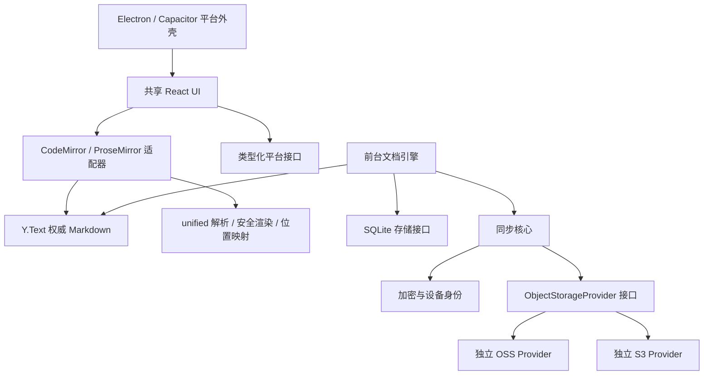

# JoplinU 架构决策与阶段边界

状态：0.2.0 开发版，已接入本地日志、前台加密同步、快照恢复、整库迁移与密钥轮换；尚未通过全部平台与同步发布门槛。优先级：不丢失数据 > 同步正确性 > 编辑体验 > 平台一致性 > 性能与外观。

## 仓库实查（2026-10-22）

目标仓库 `UlinoyaPed/joplinu` 默认分支 `dev`，起点 `585ec251b056eb0665f6a2e0eee4e012b32e2f6e`（Doc: Auto-update documentation）。远端检查时只有 `dev` 分支。本地浅克隆初始工作区干净。它已经包含完整 Joplin 工程：根 Yarn 4.16 workspace，Electron 桌面、React Native 移动端、CodeMirror / ProseMirror 编辑器、SQLite、本地模型、同步和加密实现，并非空的新工程。没有发现 AGENTS.md；读取并遵循根 CLAUDE.md 中适用的工程约定。

保留原有应用、许可证、资源与数据路径。后续按用户明确要求移除了旧 Joplin 机器人、构建 workflow 和开发说明，根 README / AGENTS 改为 JoplinU 入口。新工程暂置于 `experiments/joplinu/`，以独立 npm workspace、锁文件和严格 tsconfig 验证新架构，避免触发旧工程全部原生依赖安装。它不属于旧根 workspace，不导入任何 `@joplin/*` 模块。根 TypeScript 排除该目录，新工程自行检查。原型成功后可以在独立提交中提升为正式 apps/packages 工程；现在不迁移旧项目，也不改旧数据库。

参考并读取了原有 `packages/editor/CodeMirror/extensions/rendering/`、`ProseMirror/schema.ts` 附近的模块结构、`ProseMirror/utils/UndoStackSynchronizer.ts`、`packages/lib/Synchronizer.ts`、`readme/dev/spec/{sync,sync_scroll}.md`、`readme/dev/spec/e2ee/native_encryption.md`。采用其分层、选区避让和源码位置映射经验，没有复制实现或同步协议。根 LICENSE 默认 AGPL-3.0-or-later 继续适用；未复用 Joplin 商标图标。

## 模块与依赖方向

当前实现包括 `apps/playground`、Electron `apps/desktop`、Capacitor/Kotlin `apps/android`，以及 `packages/document`、`packages/editor`、`packages/markdown` 和最小 `packages/platform` 导出适配。新增 packages/library、database、core、crypto、sync 与独立 storage 接口；Electron / Android 平台主机负责 OSS / S3 传输和安全凭据保管，前台加密同步核心仅依赖统一 Provider，详见 [storage.md](storage.md)。原型各目录尚使用相对 TS 入口；依赖在原型 workspace 根集中锁定，待边界稳定后拆成独立可发布包。

业务核心不能依赖 Electron、Capacitor、DOM、SDK 或应用全局状态。编辑器可以依赖 DOM，Markdown 解析与 HTML 字符串生成不依赖浏览器。云 SDK 只能位于各自 Provider。跨进程调用使用逐项校验的白名单 IPC，禁止通用执行 / 任意文件路径代理。

## ADR-001：先验证原始 Markdown + Y.Text

一个 note 一个 Y.Doc，权威内容为命名 `markdown` 的 Y.Text。初始化只允许一次创建共享基线，不能让设备分别插入同一份 Markdown 再连接，否则会重复内容。原型的设备 B 从设备 A 的编码状态初始化。切换视图不创建新 Y.Doc、不写 Markdown。跨设备协议以后会封装状态更新；阶段 1 的内存传输仅用于实验。

CodeMirror 使用 y-codemirror.next 直接绑定 Y.Text。所有模式使用同一个 Y.UndoManager；本地富文本事务与 CodeMirror origin 被追踪，远端更新不进入本地撤销。模式卸载仅解除编辑器监听器，不销毁文档或撤销栈。选区保存为 Yjs RelativePosition，在切换和远端修改后恢复；Markdown 标记内部、转义文本、原子节点采用邻近位置回退，目前不是所有节点都精确映射。

富文本采用独立 ProseMirror schema，不绑定 Y.XmlFragment。原型没有同时绑定两套 Yjs 模型，也没有通过整篇 Markdown 序列化冒充双向绑定。

## ADR-002：直接评估 ProseMirror，暂不引入 Milkdown

Milkdown 是 ProseMirror 上的 Markdown 编辑框架，插件体系很有价值；本实验的主要风险是原文位置与事务补丁，需要直接控制 schema、selection 和 dispatchTransaction，所以先采用 ProseMirror。不是由于流行度换型。使用 prosemirror-markdown 的基础 schema / serializer 与 prosemirror-tables，并用 unified AST 构造投影视图。现有实验验证了普通文字、格式操作、表格单元格和并发插入；不能据此认定整个富文本适配已经成立。

处理过程：

1. unified 解析 Markdown，保存每个顶层块的原始切片、UTF-16 区间、投影节点和文本叶子映射。
2. 若事务只修改具有完全匹配源码切片的文字，直接生成对应原文字段的补丁，保留标题空格、围栏和原有标记。
3. 结构或格式改变时，匹配相同的前后顶层节点，只序列化改变的块；用有 50ms 预算的字符 diff 生成多个局部补丁。不会用一个大删除覆盖中间未变字符。
4. 重新解析候选源码，检查 ProseMirror 结构与目标事务相等；不等时拒绝提交，不改权威原文，并提供恢复草稿下载与源码回退。
5. 检查提交时的原文基线，拒绝过期事务，再在单个 Yjs transaction 内倒序应用补丁。外部更新在视图内按结构差异替换，选区通过源码相对锚点重建。

CommonMark / GFM 的标题、列表、任务项、引用、标记、链接、代码、图片和表格可以投影。新增公式 NodeView 与公式弹窗、本地图片 broker、任务开关、表格行列工具和上下文菜单；这些能力继续通过重解析等价保护。引用式链接、HTML、脚注以及已识别的自定义扩展（例如 `:::`、`[[...]]`、`{{...}}`）作为不可编辑源码原子块保留，双击切换源码。未注册扩展不存在通用自动识别方法；接入扩展必须声明投影和回退策略，测试原文保留。

局部序列化仍可能规范化同一修改块里的部分格式；不能宣称所有未编辑区域都逐字保留。普通文字快速路径与独立未修改块已经有逐字断言。段落拆分 / 合并、复杂嵌套结构、多步插件事务、富文本粘贴、空文档与多光标仍需扩大覆盖。失败草稿是额外恢复材料，不应覆盖原文，也不保证保留原始排版。

## ADR-003：输入法和远端更新边界

组合输入期间不卸载活动编辑器，远端入口 `applyRemote` 将更新暂存并在 compositionend 后应用。ProseMirror 使用异步结束回调，给 DOM observer 机会提交组合文本；CodeMirror 保留其原生 composition 处理。所有未来远端更新必须经过文档引擎入口，不能绕过此队列直接 applyUpdate。原型对同一文档的多个本地编辑器和应用切后台的组合输入取消尚需验证。

Chromium 合成 composition 事件只能验证路由和单次写入，不能证明 Android WebView / Gboard / 搜狗 / 系统输入法正确。真机必须验证候选切换、长按、选区跨格式、旋转、软键盘和撤销。用户随后要求继续完整软件实现，现有同步采用开发版边界：本地界面和正文的组合输入都会暂缓远端提交，显示“远端更新待处理”；真机输入法仍是正式发布验收项。

## ADR-004：渲染与资源安全

统一管线为 remark-parse → GFM / math → remark-rehype → 资源和源码位置插件 → rehype-sanitize → trust=false 的 KaTeX → HTML。不启用原始 HTML 解析，危险 URI 被去除，外部图片和 file/data 资源不请求；合法本地附件仅保留 data-attachment 标识，显示层从已验证资料库解析为 Blob；SVG/HTML 等不作为活动文档嵌入。自定义协议必须在平台注册并校验，不交给浏览器任意导航。

网页使用 CSP 禁止对象、表单和外部连接，脚本仅 self；样式允许编辑器必要的行内样式。笔记 / 附件内部链接由应用处理，普通预览内容点击定位源码。数学解析设展开 / 大小上限，缓存最多八个结果，异步预览有版本取消保护。当前整篇 AST 渲染并未增量化，大文档富文本解析是已知风险。

Shiki 使用 JavaScript regex engine 和按需语言 / 主题，避免为 WASM 放宽 CSP；Mermaid 按需加载、串行渲染，启用 strict 和文字上限，输出再经 DOMPurify SVG 清洗，去除活动链接 / foreignObject / 外部资源。Live Preview 依据 Lezer 增量语法树建立 StateField 块替换，单独渲染表格、代码、公式、图片切片，光标进入后显示原文；全量 1 MiB 与中文真机高度稳定性仍须测量。

实际依赖审计后将 Vitest 从 3.2 系列升级至 5.0.5（修复 mocker / tinypool 已知问题），KaTeX 从 0.16 系列升级至 0.19.0（修复 trust 限制受既有原型污染绕过的问题）。remark-math / rehype-katex 仍声明旧 KaTeX 范围，因此使用显式 overrides 统一到直接依赖版本，并以类型检查、数学安全测试和实际浏览器渲染验证兼容性，不能只强制版本而不运行验证。

## ADR-005：本地持久化与平台壳

为支持真实的目录、历史与设置流程，在完整同步门槛通过前先接入本地持久化。当前 v2 使用逐笔记 Yjs 更新日志，目录、元数据、设置、历史、附件与密文 outbox 在同一 SQLite 事务中提交，并以 revision CAS 拒绝过期窗口。串行写入完成后才更新“已保存”，写入期间产生的更改继续排队；失败保留内存与导出。读取失败不创建空库覆盖旧记录。正文日志具有校验与有界压缩；元数据、历史、附件和密文队列目前仍有聚合容量上限。具体容量和恢复限制见 [local-library.md](local-library.md)。

桌面使用主进程 node:sqlite 的 WAL / synchronous=FULL；renderer 只有带 frame / origin 校验的 read/write/check 白名单 IPC。Android 使用 Kotlin SQLite 事务和分片，避免 CursorWindow 的大行限制；浏览器预览用原子 IndexedDB，明确标示后端。SQLite 重开、进程强杀、拒绝过期写入和 Electron 实际重启已有自动测试；Android instrumentation 结果必须单独确认。

历史是持久化的原文快照，区别于会话 UndoManager。备份保留当前 Yjs 状态以恢复后继续合并，并可另行密码加密；本地 SQLite 仍是明文。多窗口当前通过拒绝过期快照保护，不宣称自动协同。已建立逐文档日志与原子持久队列；后续仍需分离附件 / 历史、引入 FTS 索引及统一窗口文档服务，迁移必须先备份并可回滚。

Electron 已开启 sandbox/contextIsolation，关闭 nodeIntegration，限定 joplinu 协议的资源根目录；外部 HTTP(S) 链接仅交给系统浏览器，拒绝应用内外部导航、任意新窗口与权限请求。Capacitor 共享 React 与文档核心，Kotlin 负责 SQLite；附件导出使用应用 cache 和受限 FileProvider。Android WorkManager 仅传输已加密且持久化的字节，不确认或删除前台队列；合并需要前台文档引擎，不假设后台 JS 活跃。后台下载成功不等于已经合并。

## ADR-006：OSS / S3 统一语义（阶段 3，独立适配器已实现）

Provider 必须有 put/get/list/head/delete；list 传递不透明游标并实际走完分页。NotFound、Authentication、Permission、Timeout、Network、Integrity、Unsupported 和 Cancelled 分别建模，只有明确可重试的临时失败按退避及抖动重试，取消与总时限可控，错误日志去除凭据和签名 URL。head 不存在返回 null，其他失败抛结构化错误。put 默认不是 CAS：上层只生成不可变随机对象 key，重试复用已持久化的相同密文。可选能力显式声明 conditionalPut、versioning，不参与正确性的最低假设。

OSS 使用官方 ali-oss 或经验证 API，endpoint/bucket/prefix/STS 单独处理；S3 使用 AWS SDK v3、自定义 endpoint/region/path-style/SigV4/会话 token。二者不是同一个 Provider。设置界面记录类型、endpoint、region、bucket、prefix、临时凭据、path-style 和安全 TLS 选项，凭据只传给平台安全存储。连接测试在随机隔离前缀测试 put/head/list/get/delete，显示每项权限结果并清理自己创建的对象，不删除用户已有对象。禁止生产默认关闭证书验证。

已实现统一接口、官方 OSS V4 与 S3 SigV4 适配器、分页 / 重试 / 诊断。实际 S3 服务使用 SeaweedFS 4.49，验证了权限、响应丢失、分页及持久化等九项；MinIO 官方分发当前不可访问，替代选择及哈希见 storage.md。真实 OSS、MinIO、R2 / AWS / Ceph / Wasabi 必须逐端点记录行为，不能用本地 OSS 协议 fixture 或厂商品牌声明代替实测。当前没有真实 OSS 凭据，未执行个人云端读写。设置 UI、平台密钥保管与 Android 请求桥均已接入；真实 S3 已验证前台同步，真实 OSS 仍待独立凭据环境验收。

## ADR-007：不可变日志与 E2EE（已实现，开发版）

对象位于随机 vault 域下的 `keys/`、`updates/<device>/` 和 `snapshots/`。标题、标签、历史、组织信息与附件位于加密更新 / 快照内；对象名仍泄露尺寸、时间和设备活动。密文先进入 SQLite outbox 并持久化，然后上传；响应丢失重用相同路径和字节，下载校验并原子记录已处理集合。不会共同覆盖一个可变对象，也不依赖 CAS / 版本控制。

实际选用 Electron / Android 均可用的 Web Crypto：随机 256-bit 主密钥、HKDF-SHA256 按对象路径派生 AES-256-GCM 密钥、随机 96-bit nonce，完整路径与版本作为 AAD。主密钥由 PBKDF2-SHA256 600000 次派生的密码密钥包装。相较最初拟选 libsodium，可直接使用平台成熟密码实现，无额外 WASM / 原生密码库装载；代价是 PBKDF2 不具备 Argon2id 的内存难度。口令强度仍重要。封包 / 参数有界验证，密钥仅在当前前台会话解锁，不上传明文主密钥。

恢复码保存 vault / key 身份，新设备通过恢复码与密码取得密钥。轮换将完整历史认证后重新加密到新随机 vault 域，快照覆盖关系与哈希同步改写，验证全部对象后发布新密钥清单；旧设备可带离线修改加入新域。旧域保留用于恢复，旧密钥仍能解密旧历史，不能将轮换宣称为远程撤销旧数据。

AEAD 证明对象由持有共享主密钥的一方生成；当前没有独立设备签名或逐设备撤销。已见对象哈希可发现缺失 / 内容变更，去重防止重复应用；全新设备面对完整旧副本不能独立检测全部回滚，必须保留独立备份 / 恢复锚点。OS 安全存储保护云凭据：Linux 拒绝 basic_text，Android 使用 Keystore。长期和 STS 凭据均不进入笔记、日志或安装包。

快照索引最后上传作为完成标记，验证各密文分片及覆盖集合后恢复，再重放剩余日志。第一版不删除远端历史，也不做附件 GC。永久删除与长期离线编辑冲突时将未覆盖修改恢复到回收站并提示。迁移复制并验证全部密文对象，包括密钥元数据、日志、快照与附件，验证后切换配置，源仓库保留。

## ADR-008：Y.Text 验证失败时的替代方案

| 模型 | Markdown 保真 | 并发合并 | 历史恢复 | 复杂度 |
| --- | --- | --- | --- | --- |
| 原始 Markdown Y.Text + 局部富文本投影（当前实验） | 独立未改块完全保留，块内依赖映射 | 字符级收敛；语法合法性不自动保证 | 保留更新与原文，需持久化 | 适配器复杂，插件需逐项验证 |
| Y.XmlFragment / 结构树为权威 + Markdown 导出 | 需要额外保存原始片段与扩展，否则会规范化 | 结构化事务更自然 | 树更新和导出版本 | 源码编辑需可靠解析事务，双向更复杂 |
| 块级 Y.Map + 每块 Y.Text + 有序块集合 | 原块原文保留较容易 | 块内文本合并，跨块拆分 / 移动需定义 | 分块快照与目录版本 | 块身份、引用、选区、迁移成本较高 |

如果真实输入法、多步富文本编辑或源码保真门槛无法达到，不直接部署当前模型；以失败用例对比后二者的可行性，再写新的 ADR。Yjs 的文字收敛不代表并发 Markdown 格式操作语义正确，不能把这点推给存储 Provider。

## ADR-009：参考原版的信息布局，保持独立实现

桌面将文件夹 / 标签、笔记列表、编辑器分为独立面板，用 CSS Grid 与有界栏宽，不引入旧 ResizableLayout 树和插件布局状态。1100px 以下导航变为抽屉，700px 以下列表与编辑器单屏切换；隐藏视图保持挂载，避免为了导航重置文档、选区或 UndoManager。栏宽 / 显示设置纳入本地设置与备份，旧资料采用缺省迁移。文件夹移除采用提升直接子项而非递归删除，以保留内容与身份；批量操作统一在控制器完成校验后提交一个资料快照。同步门槛保持不变。
